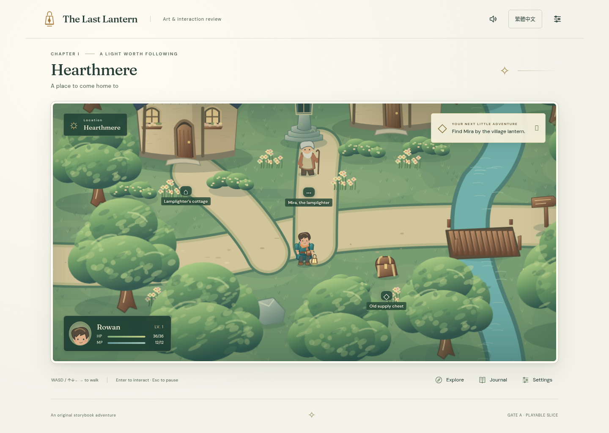

# The Last Lantern / 最後的引路燈

An original single-hero, bilingual storybook RPG. **Gate A art and interaction candidate; human acceptance pending.** Only the first-lantern vertical slice is implemented. No public deployment or Gate B production is authorized.

## Review Gate A

[Download the playable ZIP](https://github.com/jaychtw/the-last-lantern/raw/refs/heads/main/playtest/the-last-lantern-gate-a.zip) · [Watch the gameplay excerpt](docs/evidence/gate-a-gameplay.mp4) · [Read the QA and limitations](docs/GATE-A-REVIEW.md)

Extract the ZIP, then follow `START-HERE.txt` to run its Python 3 helper. No cloud workspace access or Node/npm installation is needed to play. [Playtest instructions and checksum](playtest/README.md).



[Phone gameplay in Traditional Chinese](docs/evidence/gameplay-390-zh-TW.png) · [Animated battle screenshot](docs/evidence/battle-1440-en.png) · [Cottage interior](docs/evidence/interior-1440-en.png)

## Develop

Node **24.19.0** and npm. Use the existing isolated checkout at `/workspace/the-last-lantern`; do not create a worktree for ordinary cloud tasks.

```sh
npm ci --cache /workspace/.npm-cache
npm run dev -- --port 5173 --strictPort
```

Outside the cloud, use your checkout directory and omit the cache override. The app initializes PixiJS with WebGL and uses a Canvas2D adapter for detected software GPUs. Both paths render the same assets and scene graph. All art, fonts and synthesized audio are local; no credentials, accounts, backend, telemetry, CDNs or runtime service dependencies.

```sh
npm run typecheck
npm test
npm run build
npm run test:browser
npm run package:playtest
```

Browser checks start a production preview at port 4173 and test the actual `/the-last-lantern/` project subpath; leave that port free. Tests use `/usr/bin/chromium` and `/usr/bin/ffmpeg` when present. `CHROMIUM_PATH` selects another Chromium. Elsewhere install Playwright's matching Chromium/FFmpeg with `npx playwright install chromium ffmpeg`; the wrapper only configures the system tools on cloud machines that already have them. No TLS, checksum or signature checks are disabled.

`npm run package:playtest` creates a ZIP under `playtest/`. Extract it, then run its Python helper; players need Python 3 and a browser, no npm installation. The helper serves only the bundled `game/` directory. Its default bind is local; `--lan` is opt-in for a phone on the same trusted network. This produces a review artifact and does not publish a site. Relative asset URLs support static project subpaths. A service worker/PWA is deferred; offline network independence after the files are served is distinct from offline installation.

## Play this chapter

Speak with Mira by the village lantern. Visit her cottage, open the optional supply chest, then follow the eastern road to Meadow Path. Calm the Dewdrop Blob and rekindle the Meadow Lantern. The chapter has a completion state and can be restarted from settings after confirmation.

- Desktop: WASD/arrows to walk. Enter, E or Space to interact while the scene is focused. Escape pauses. Mouse clicks walk along collision-aware routes.
- Touch: four direction buttons and Interact. **Explore** offers named destinations; selecting one walks the hero through the same map geometry. The camera follows the hero on narrow screens; no gameplay is shrunk to fit a whole map.
- Combat: Attack, Ember, Mend, Tonic, Guard, Flee. A breath telegraphs the next heavy splash. Guard reduces incoming damage by 65%; retreat has a 75% success chance. Defeat costs 10% of coins (rounded down) and returns the hero fully recovered to the cottage.
- English/Traditional Chinese switches live. Settings includes reduced motion, larger text, faster battles, sound/volume, three manual saves and load. The world pauses in menus, dialogue and battles. Audio starts only after user interaction and is muted by default.
- Saves are schema/version checked. Bad saves stay intact; blocked storage allows session play. Starting a new session beside a corrupt autosave protects that autosave and directs the player to manual slots.

Portrait is recommended on phones for Gate A. Short landscape layouts keep a minimum 300px scene and scroll vertically to the direction controls; Explore provides an alternative when the whole scene and controls cannot fit together. Physical-phone ergonomics remain unverified. For measured cloud frame timings, run `npm run measure` while a production preview is serving `/the-last-lantern/` on port 4173; `LANTERN_MEASURE_URL` can select the extracted Python-served playtest instead. Keep other browser/recording workloads stopped during measurement.

## Authority and review

- [Supplied GDD v1.0](docs/design/GDD-v1.0.txt), unchanged.
- [UGDS v1.0.0](docs/design/UGDS-v1.0.0.md), unchanged at `jaychtw/game-development-standards@d5c6696efdd6efc028118600466db44aecae0c9b`.
- [Architecture, pipeline and engineering references](docs/ARCHITECTURE.md).
- [Asset provenance](docs/ASSETS.md), [third-party notices](docs/THIRD-PARTY-NOTICES.md).
- [Gate A evidence, results and known limits](docs/GATE-A-REVIEW.md).

The layered-vector art is an original visual candidate. Local functional checks do not establish the requested visual polish, phone performance, human acceptance, CI success or deployment. Gate B requires explicit acceptance of this running slice; release requires separate authorization.
