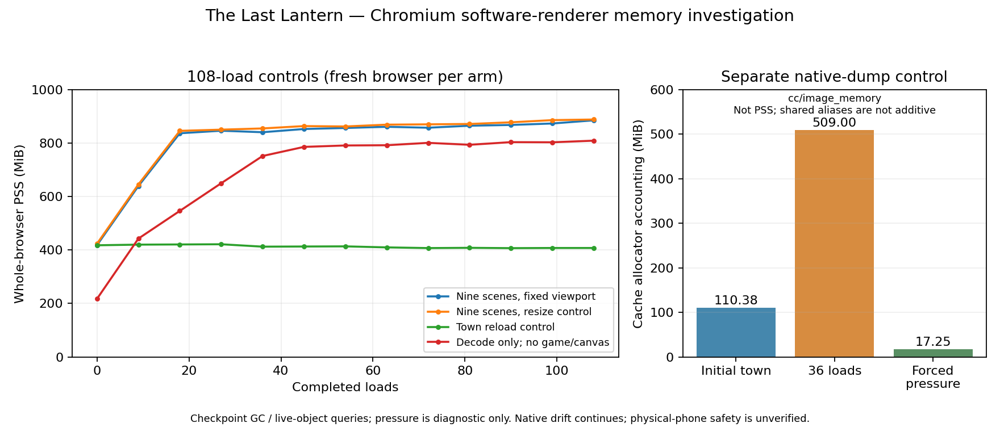

# Gate C follow-up — hardware validation and memory investigation

**Release-readiness recommendation: Not ready for final production acceptance.** The owner has played `b763562` on a real desktop and accepted its smoothness and visual presentation. This is valuable physical-device experience evidence, but no measured desktop FPS, device specification or confirmed Canvas backend was supplied. The original 20% town regression is not reproduced in the new controls. Substantial native-memory growth is now traced primarily to Chromium image-cache accounting, with no demonstrated accumulating game-resource leak. Physical-phone performance/native-memory safety and numerical desktop validation still need the owner-run diagnostic below. No public deployment or production acceptance is performed.

Review date: **2026-10-26 (Asia/Taipei)**. Source baseline: [`b763562`](https://github.com/jaychtw/the-last-lantern/commit/b763562fe3b5a23e8d6705cc959310573ee05c77). [Owner approval record](APPROVALS.md). The pinned GDD/UGDS, accepted renderer, artwork, animation, lighting, composition, resolution/DPR cap, rules, saves, localization and audio are preserved. The only normal-entry change conditionally loads the optional diagnostic; no game/render-loop optimization or new unloading policy is shipped.

[Download review ZIP](https://github.com/jaychtw/the-last-lantern/raw/refs/heads/main/playtest/the-last-lantern-gate-c.zip) · **[Desktop/phone procedure](PHYSICAL-DEVICE-VALIDATION.md)** · [Historical Gate C report](GATE-C-REVIEW.md)

## What is and is not established

| Evidence | Status / interpretation |
| --- | --- |
| Owner's actual desktop playtest | Smooth, visually satisfactory, faithful to evidence; accepted visual baseline. Subjective report, not numerical FPS or verified acceleration. |
| Cloud Chromium | Verified software backend and CPU-bound town composition. Quantitative results below apply to this environment. |
| Hardware-accelerated Chromium on representative hardware | **Unavailable here.** No exposed `/dev/dri` or DRM device; Chromium reports software Canvas/compositing/rasterization and SwiftShader. No physical GPU result is claimed. |
| Physical Android/iOS | **Not measured.** The diagnostic package is ready for owner use; touch emulation and UA strings do not certify a phone. |

### Cloud/desktop discrepancy and the town regression

The cloud is headless Chromium **154.0.8037.57**, Linux 6.18.55 x64, Xeon Platinum 8370C, 5 exposed logical CPUs and a 4-CPU-equivalent container quota. `2d_canvas: unavailable_software`, `gpu_compositing: disabled_software`, `rasterization: disabled_software`. The reported graphics implementation is SwiftShader. A flag enabling a GPU API backed by SwiftShader would still be CPU software, not hardware validation; the original explicitly enabled SwiftShader control was already much slower and is not repeated as a hardware test.

During the primary traversal controls, main-thread CPU time is about **99.6–99.7%** of its counter window; renderer-process CPU is about **1.56–1.60 core equivalents**. The main thread is occupied, not merely producing an incorrectly averaged 30-FPS number. The 24 primary windows record **zero cgroup throttle events**. This does not rule out shared-host scheduling or other unmeasured environmental effects. The original Canvas/native-raster profiles remain relevant; no new asset/network bottleneck is asserted.

A physical desktop can have a faster CPU and a genuinely accelerated Canvas/compositing backend. Stable lower FPS can also feel smooth. Both are plausible explanations for the subjective/quantitative difference; neither is established for the owner's machine until a device/browser report is supplied. The observations are not contradictory measurements of the same device.

We tested immutable Gate B and Gate C ZIPs on one loopback origin with identical browser/viewport/DPR and input schedules, plus a byte-identical Gate C replica. Then eight windows used **exactly the same Gate C URL and JS hash** under two labels, followed by two 60-second windows at that same URL. All **34 windows** are retained, including unfavorable tails. `b` = Gate B, `c` = `b763562`, `replica` = identical Gate C bytes; it is not another optimization.

| Control | Source | Runs | FPS | p95 ms | p99 ms | 1% low | >50.5 ms |
| --- | --- | ---: | ---: | ---: | ---: | ---: | ---: |
| controls / traversal | b | 4 | 30.9 | 33.5 | 50.1 | 15.0 | 6 |
| controls / traversal | c | 4 | 32.1 | 33.4 | 50.1 | 14.3 | 13 |
| controls / traversal | replica | 4 | 33.2 | 33.4 | 50.0 | 20.0 | 0 |
| controls / animated-idle | b | 4 | 34.0 | 33.4 | 50.1 | 12.9 | 14 |
| controls / animated-idle | c | 4 | 34.3 | 33.4 | 50.0 | 15.0 | 10 |
| controls / animated-idle | replica | 4 | 37.0 | 33.4 | 33.4 | 24.5 | 0 |
| identical-url / traversal | c | 4 | 31.6 | 33.4 | 50.0 | 16.8 | 6 |
| identical-url / traversal | replica | 4 | 29.6 | 50.0 | 83.3 | 7.2 | 39 |
| long-window / traversal | c | 1 | 31.8 | 33.4 | 50.0 | 19.0 | 1 |
| long-window / traversal | replica | 1 | 32.9 | 33.4 | 50.1 | 13.2 | 14 |

The original 38.0 → 30.4 FPS result remains in the historical report. It does **not reproduce as a consistent Gate C slowdown** here: the primary traversal pools are 30.9 versus 32.1 FPS. Different runs of the exact same URL/code produce different distributions, including worse tails, without an application change. This limits a causal interpretation of the earlier comparison; it does not prove the exact historical cause or justify discarding that evidence. Longer windows still report about 32 FPS in software town rendering, so extending measurement alone does not make the cloud meet 60 FPS.

These are pooled interval distributions, not averages of instantaneous FPS. Primary windows are 12 seconds, with 2-second warmup, 1440×1000 CSS pixels/DPR 1, default English/motion, muted audio and the original 600 ms/second WASD rectangle; animated idle is separate. Counterbalance reverses source order each repetition. Longer controls last 60 seconds. Each window gets a fresh browser. CDP CPU counters are taken at boundaries; unlike the original Gate C harness, the new controls omit once-per-second CDP heap/counter polling and instead retain positions once per second. This is an explicit method difference; new B/C comparisons are internally matched, not an exact rerun of every historical condition. Cold OS/disk caches, deterministic physical presentation, thermal behavior and compositor dropped-frame counters are not established. No QA, encoding, other browser or trace-analysis workload overlaps an active performance window.

[Primary raw controls/environment](evidence/gate-c-followup/town-controls.json) · [identical URL](evidence/gate-c-followup/town-identical-url.json) · [60-second controls](evidence/gate-c-followup/town-long-window.json) · [pooled statistics and CPU windows](evidence/gate-c-followup/investigation-summary.json).

## Memory: controlled extended loading

Four fresh-browser arms each complete **108 loads**: nine-scene cycling at fixed size, the same scenes with the earlier resize schedule, repeated town loads, and a decode-only page with **no game, DOM interface or canvas**. The decode-only control keeps only the current region's image set, derived from the real game's live resources. Game arms use actual confirmed slot loads of validated stable fixtures; these are load stress tests, not narrative playthroughs. No allocation/CPU profiler is attached to these four arms.

| Memory control (108 loads) | Start MiB | 18 loads | 54 loads | 108 loads | 30 s idle | Diagnostic pressure | Images / canvases |
| --- | ---: | ---: | ---: | ---: | ---: | ---: | ---: |
| scene-fixed | 418.1 | 836.4 | 856.2 | 884.8 | 874.1 | 371.2 | 42 / 1 |
| scene-resize | 423.6 | 845.6 | 861.9 | 887.9 | 878.8 | 377.5 | 42 / 1 |
| town-fixed | 417.6 | 420.7 | 413.6 | 407.5 | 401.6 | 290.2 | 39 / 1 |
| decode-only | 217.5 | 546.2 | 790.8 | 808.8 | 773.2 | 296.4 | 42 / 0 |



At the repeated scene endpoint, the application arms retain **42 live images and one canvas**; repeated town retains 39/one, decode-only 42/zero. Each arm's image URLs/dimensions, DOM node count and listener count stay identical at all twelve cycle endpoints. Post-GC V8 heap ends around **2.12–2.15 MiB** for the game arms. One town repeatedly reloaded does not show the region-cycling increase. The no-game decode control reproduces most of that growth, so application DOM, battle remounts, canvas resizing and accumulated game references are not required to produce it.

A separate detailed memory-infra trace uses 36 scene loads. Its renderer accounting identifies `cc/image_memory` and its nested decoded-image caches as the large changing allocator category:

| Detailed native dump | cc/image_memory accounting MiB | Renderer malloc accounting MiB |
| --- | ---: | ---: |
| start | 110.38 | 24.12 |
| end | 509.00 | 33.63 |
| pressure | 17.25 | 25.26 |


Whole-browser PSS and these allocator sizes are different measures. Browser/renderer discardable/shared-memory paths can alias the same allocation; nested allocator categories must **not** be added together. The native trace itself adds overhead, so its PSS is not substituted into the untraced control table. The published excerpt preserves original allocator values, process totals, IDs and chronology; mmap addresses and ownership graphs are omitted for size. The complete execution-only trace hash and reproduction command are recorded. Exported trace IDs are normalized; three successful explicit requests are matched to the three allocator groups by chronological order.

**Diagnosis:** reproducible native/cache growth, largely reclaimable under pressure, with no demonstrated accumulating application-resource leak in these controls. Browser cache retention and native allocator behavior account for much of the difference between small JS heap/logical pixels and process footprint. This is stronger evidence than heap size alone, but it is not proof of a leak-free browser or a safe phone budget. Growth slows markedly after region warmup but still drifts between 18 and 108 loads; 30 seconds of ordinary idle does not reclaim it fully. A forced diagnostic pressure notification is not normal gameplay and is not a production remedy.

**Fix decision:** no evidence supports changing the accepted asset loading, references or renderer. No aggressive unload, forced GC, production memory-pressure call, fidelity reduction or scene simplification is added. Such changes could create unnecessary decode/loading stutters. The optional diagnostic's result buffers and work are bounded; it collects no save data and runs no sampler when inactive.

[All load timings, live objects, DOM/listeners, PSS and reclamation controls](evidence/gate-c-followup/memory-controls.json) · [detailed native control](evidence/gate-c-followup/memory-native-dumps.json) · [compressed original allocator excerpt](evidence/gate-c-followup/native-allocator-events.json.gz) · [shareable plot](evidence/gate-c-followup/memory-controls.svg).

## Physical-device diagnostic and verification

The [owner procedure](PHYSICAL-DEVICE-VALIDATION.md) needs only the existing Python helper and a browser. Append `?diagnostics=1`; record 60 seconds or 3 minutes, play normally, and download/copy JSON. The panel reports FPS/distributions/tails, scene/mode/viewport/DPR, stutters, available JS heap and logical texture estimates. Desktop/Android/iOS and acceleration fields are explicitly **owner reported**. Standard page APIs cannot certify Canvas2D acceleration or native memory. The optional WebGL probe is labeled separately and releases its own context. Exports remain local until manually shared. Clipboard fallback works on ordinary LAN HTTP. Paused states/boundary gaps remain visible; hiding the page ends capture rather than merging a hidden interval into gameplay.

Frozen install and strict TypeScript/Vite build pass; **35/35 domain/statistics tests** and **25/25 browser checks** pass, with no failed, skipped or flaky checks. The complete final suite uses two workers and takes 14.5 minutes. English desktop campaign: **705.8 s**, through all three bosses/lanterns, ending/credits and meaningful saved reload. Traditional Chinese touch campaign: **647.2 s**, through all three bosses/lanterns, ending/credits and meaningful saved reload. The three diagnostic checks are included in the 25, not counted again. Dependency audit reports **zero known vulnerabilities**. These are local checks, not CI or physical-device certification.

[Build](evidence/gate-c-followup/build.txt) · [domain log](evidence/gate-c-followup/domain-tests.txt) · [browser summary](evidence/gate-c-followup/browser-summary.json) · [full browser results](evidence/gate-c-followup/browser-results.json) · [dependency audit](evidence/gate-c-followup/dependencies.json).

All **30 visual pairs** pass the original unchanged thresholds; all **12 combat pairs are pixel-identical**. Worst mean channel error is **0.002703/255**, with no pixel over 16 levels. All 79 art/manifest files and the accepted renderer, domain, content, localization, audio, styles and governing documents remain byte-identical. [Preservation proof](evidence/gate-c-followup/preservation.json) · [comparison data](evidence/gate-c-followup/visuals/visual-comparison.json). Numerical checks support preservation rather than granting new aesthetic acceptance.

[Town before](evidence/gate-c-followup/visuals/visual-before-town-1440-full.png) / [after](evidence/gate-c-followup/visuals/visual-after-town-1440-full.png) · [phone before](evidence/gate-c-followup/visuals/visual-before-town-390-full.png) / [after](evidence/gate-c-followup/visuals/visual-after-town-390-full.png) · [cavern](evidence/gate-c-followup/visuals/visual-after-cavern-1440-full.png) · [combat](evidence/gate-c-followup/visuals/visual-after-combat-sanctum-1440-player-full.png).

[Desktop diagnostic panel](evidence/gate-c-followup/diagnostic-panel-desktop-en.png) · [desktop results](evidence/gate-c-followup/diagnostic-results-desktop-en.png) · [touch-emulated live badge](evidence/gate-c-followup/diagnostic-live-phone-zh-TW.png) · [Traditional Chinese panel](evidence/gate-c-followup/diagnostic-panel-phone-zh-TW.png) · [desktop export](evidence/gate-c-followup/diagnostic-demo-desktop-en.json) / [phone-layout export](evidence/gate-c-followup/diagnostic-demo-phone-zh-TW.json). These short automated UI/export demonstrations include screenshot work and are **not clean performance or physical-device samples**. Device fields say emulated/virtual and automatic hardware verification is false.

A separate, uninstrumented-canvas sampler control uses the final package, four fresh-browser 30-second traversal windows with reversed on/off order, 1440×1000/DPR 1, and no other browser/encoding/trace workload:

| Diagnostic sampler | Runs | Pooled rAF FPS | p95 ms | p99 ms | >50.5 ms intervals |
| --- | ---: | ---: | ---: | ---: | ---: |
| Disabled | 2 | 33.3 | 33.4 | 66.6 | 21 |
| Enabled and recording | 2 | 34.0 | 33.4 | 50.0 | 2 |

This limited, variable cloud control does not establish a precise universal overhead or a zero-cost sampler. The apparent average improvement with diagnostics is not treated as an optimization. Normal play loads no diagnostic module or styles; buffers are bounded and sampling stops when inactive. [Raw on/off control](evidence/gate-c-followup/town-diagnostics-overhead.json) · [summary](evidence/gate-c-followup/sampler-overhead-summary.json).

[63-second actual gameplay excerpt](evidence/gate-c-followup/gameplay.mp4) · [complete English recording](evidence/campaign-desktop-en.mp4) · [complete Traditional Chinese recording](evidence/campaign-phone-zh-TW.mp4) · [recording hashes/cuts](evidence/gate-c-followup/recordings.json). These are real-time 25 FPS reduced-resolution browser captures, silently H.264-transcoded; they are not numerical FPS, physical-device or audible-audio evidence.


The initial focused test found a diagnostic integration defect: battle uses `.battle-top` rather than the regular `.modal-tools`. The optional launcher now handles both; the game engine did not change. [Initial report](evidence/gate-c-followup/diagnostics-focused-initial.json) / [corrected focused run](evidence/gate-c-followup/diagnostics-focused-final.json). Final test totals count each check once.

Version **0.4.1-gate-c-followup**, **7,236,017 bytes**, SHA-256 `bfe11367a2812b62911231d3c982fce5939dd33bfce37577f58774193351cb61`. All **95** extracted hashes and **89** HTTP-served game files match. Both JS bundles and styles match the final full browser suite; packaged touch/gameplay checks and actual optional-tool exports pass on the extracted ZIP. The package includes bilingual startup directions and a standalone `DIAGNOSTICS.txt`. [Manifest](evidence/build-manifest.json) · [integrity](evidence/artifact-integrity.json) · [verified build](evidence/gate-c-followup/verified-build.json) · [packaged gameplay](evidence/playtest-verification.json). The accepted `b763562` ZIP remains available at its immutable commit; this review package does not imply production approval.

## Reproduce the targeted investigation

Install the frozen lockfile and use Node 24.19.0/system Chromium as in README. In one terminal:

```sh
python3 scripts/serve-investigation.py
```

It verifies/extracts immutable Git artifacts at `c6ba550` and `b763562`, serving `/b/`, `/c/` and identical `/replica/` on loopback port 8095. In another terminal, with no concurrent browser/encoding/trace work:

```sh
node scripts/investigate-town.mjs
LANTERN_TOWN_IDENTICAL=1 LANTERN_TOWN_MODES=traversal LANTERN_TOWN_LABEL=identical-url node scripts/investigate-town.mjs
LANTERN_TOWN_IDENTICAL=1 LANTERN_TOWN_MODES=traversal LANTERN_TOWN_REPEATS=1 LANTERN_TOWN_DURATION=60000 LANTERN_TOWN_LABEL=long-window node scripts/investigate-town.mjs
node scripts/investigate-memory.mjs
LANTERN_MEMORY_ARMS=scene-fixed LANTERN_MEMORY_CYCLES=4 LANTERN_MEMORY_TRACE=1 LANTERN_MEMORY_LABEL=native-dumps node scripts/investigate-memory.mjs
node scripts/summarize-followup.mjs
```

For the sampler control, serve the extracted current ZIP on port 8096, then run:

```sh
LANTERN_TOWN_CANDIDATE=http://127.0.0.1:8096/ LANTERN_TOWN_DIAGNOSTICS=1 LANTERN_TOWN_IDENTICAL=1 LANTERN_TOWN_MODES=traversal LANTERN_TOWN_REPEATS=2 LANTERN_TOWN_DURATION=30000 LANTERN_TOWN_LABEL=diagnostics-overhead node scripts/investigate-town.mjs
```

Raw native traces go to `/tmp`; the compact allocator excerpt is published. `MPLCONFIGDIR=/tmp/lantern-matplotlib python3 scripts/plot-followup.py` optionally regenerates the graph with Matplotlib 3.10.8. No plotting/art-authoring tools are needed to play. `CHROMIUM_PATH` selects a Chromium executable; `LANTERN_HEADLESS=0` permits an actual desktop window when available, without claiming that the selected backend is a physical GPU.

## Outstanding decisions and release boundary

- Desktop numeric performance/acceleration, physical Android/iOS performance and native-memory budget remain unverified. The owner report is accepted as experience/visual evidence, not converted to an FPS figure.
- Software-cloud exploration still misses 60 FPS and sometimes stutters. New controls undermine a simple code-regression attribution; they do not make the original trace or current low FPS disappear.
- Native image-cache use can matter on a phone even when references are bounded and memory is reclaimable. Longer play, tab termination, thermal throttling and ordinary-pressure recovery need physical-device evidence.
- Safari/Firefox, screen readers, manual contrast/ergonomics, audible audio quality, independent balance/pacing and the 2–4-hour aspiration remain separate review items. No exception to pinned UGDS/GDD is inferred.

UGDS S03 remains **Not Verified** for numerical representative-hardware/mobile acceptance; the measured software-cloud desktop target remains **Fail**. The accepted artistic baseline is preserved; new diagnostic and automated evidence do not confer production acceptance. Source push, local verification, CI, public deployment and owner acceptance remain separate statuses. Stop for owner review; no public deployment.
